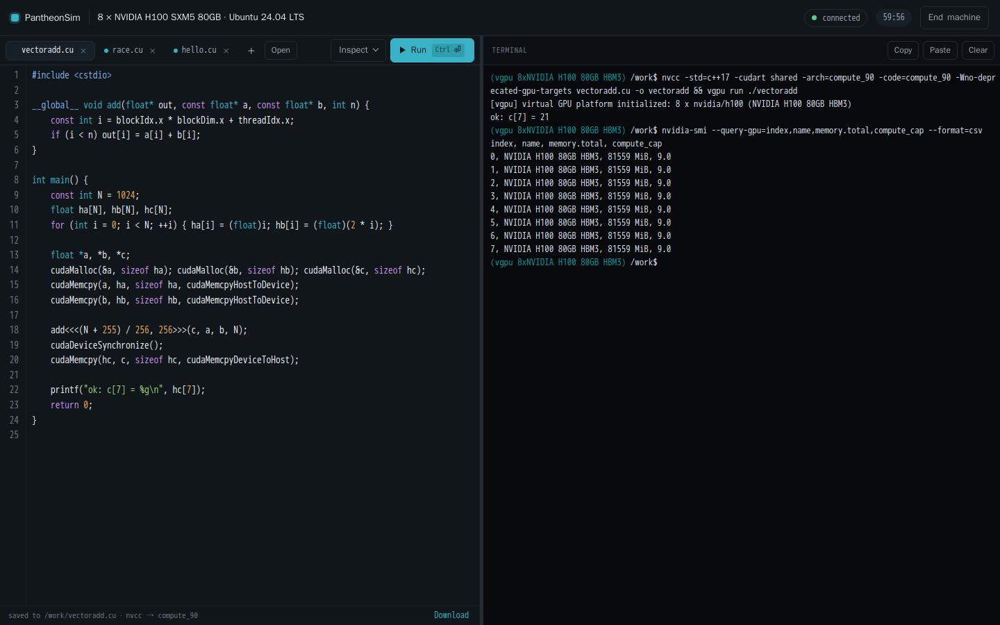

# PantheonSim

**Run CUDA and HIP programs, unmodified, on a CPU. No GPU needed.** It pretends to be an NVIDIA or AMD GPU (a T4, an H100, an MI300X), so programs built with the real `nvcc` or `hipcc` run on it unchanged. It checks what your code does, not how fast it runs: there is no timing model, so a run on a physical GPU before a release still counts.

[](https://pantheonsim.com/play/)

## Run it

```bash
make     # installs cmake and a C++ compiler if missing (asks first), then builds
./run    # starts a simulated GPU machine and takes you inside; type exit to leave
```

You need Linux (WSL works), a C++20 compiler and CMake, and no GPU. Run both commands from the repository root: `make: *** No targets specified` or `./run: No such file or directory` means you are in another directory or on an old branch, so `git checkout main && git pull` first. `make doctor` checks the tools and says what to install, `make deps` installs them, and `make build` builds without installing anything. The build takes a few minutes and uses half your CPUs (`make JOBS=8` to choose). The simulator also runs on half your CPUs; set `threads: N` in the settings file, or `make run THREADS=N`, to change that. `./run` before `make` builds for you.

Other targets:

```bash
make demo                           # run a built-in vectorAdd kernel on a simulated H100; ends with PASS
make run APP=./my_app ARGS="..."    # run one program on the simulated GPU, without the machine shell
make test                           # build and run the test suite
make help                           # every target and setting
```

Inside, `nvidia-smi` shows the GPUs, and you can compile, download programs with `curl` or `git clone`, and run them; for Python packages use a virtual environment (`python3 -m venv ~/v && ~/v/bin/pip install ...`); system packages (apt) are installed on your own machine, outside.

## Choose your machine

Put the settings in a file, for example `my.yaml`, then `./run my.yaml`. [pantheonsim.example.yaml](pantheonsim.example.yaml) lists every setting and runs as it is (`./run pantheonsim.example.yaml`); copy it to `pantheonsim.yaml` to make it the default, which is also what `./run` writes for you on a first run:

```yaml
gpu: nvidia/h100     # which GPU (build/vgpu list-gpus shows them all)
count: 8             # how many
strict: true         # refuse undefined behaviour, such as dividing by zero
```

In a browser: [pantheonsim.com/play](https://pantheonsim.com/play/). In CI: `pantheongpu/setup-pantheonsim@v0` ([docs/github-action.md](docs/github-action.md)), or `scripts/ci-setup.sh` on GitLab CI, CircleCI, Forgejo, Jenkins and Buildkite ([docs/ci-other-platforms.md](docs/ci-other-platforms.md)). In a container: `docker run --rm ghcr.io/pantheongpu/pantheonsim:latest vgpu list-gpus` ([docs/docker.md](docs/docker.md)).

## Docs

[Getting started](docs/getting-started.md) (step by step, your own programs, first-run fixes) | [Settings](docs/config.md) | [The machine](docs/machine-simulator.md) | [Compilers](docs/toolchains.md) | [Commands](docs/cli.md) | [Status and limits](docs/status.md) | [Architecture](ARCHITECTURE.md) | [Governance](GOVERNANCE.md) | [Security](SECURITY.md)

Questions go in [Discussions](https://github.com/pantheongpu/pantheonsim/discussions), bugs in [issues](https://github.com/pantheongpu/pantheonsim/issues). Apache-2.0 (see LICENSE); CUDA is a trademark of NVIDIA, and this project is not affiliated with NVIDIA or AMD.
